<picture>
  <source media="(prefers-color-scheme: dark)" srcset="https://raw.githubusercontent.com/VersinoPsiOmega/.github/main/profile/assets/hero-dark.svg">
  <source media="(prefers-color-scheme: light)" srcset="https://raw.githubusercontent.com/VersinoPsiOmega/.github/main/profile/assets/hero-light.svg">
  
</picture>

[](https://pypi.org/project/semvec/)
[](https://pypi.org/project/semvec/)
[](https://semvec-docs.pages.dev)
[](https://www.semvec.io)
[](https://www.semvec.io)

Semvec replaces unbounded conversation history with a **fixed-size semantic state
vector** plus a tiered, content-aware memory. The input cost of every LLM call stays
constant, and the agent keeps structured access to decisions, invariants, error
patterns, and prior context across sessions.

Drop-in alternative to mem0, Letta, and LangChain Memory.

<br>

## The curve everyone else is on

```text
   input tokens per turn

   full-context replay                    semvec
   ────────────────────────────────       ────────────────────────────────
   turn      10   ▐█▌                     turn      10   ▐█▌
   turn     100   ▐████▌                  turn     100   ▐█▌
   turn   1 000   ▐█████████▌             turn   1 000   ▐█▌
   turn  10 000   ▐████████████████…      turn  10 000   ▐█▌

   O(n) · grows with history              O(1) · fixed-size state vector
```

Every other dedicated memory system on the LOCOMO leaderboard runs at least one
generative LLM pass per stored turn. Semvec runs **zero**. Ingest is a deterministic,
in-process, sub-millisecond `state.update()`.

<br>

## What actually happens to a turn

```text
   conversation ──▶ your embedder ──▶ ┌────────────────────────────────┐
                    (bring your own)  │  semvec state · 384-d / 768-d  │
                                      │  ├── short-term tier           │
                                      │  ├── medium-term tier          │
                                      │  ├── long-term tier            │
                                      │  └── verbatim cache            │
                                      │      IBANs, prices, IDs        │
                                      │      bit-exact, Decimal        │
                                      └────────────────┬───────────────┘
                                                       ▼
                                          compact, fixed-budget context block
                                                       ▼
                                             any LLM system prompt
```

No API key. No base URL. No network round-trip. No telemetry. The `semvec` package
runs entirely in-process.

<br>

## Start

```bash
pip install semvec
```

```python
from semvec import SemvecState, SemvecConfig
from semvec.token_reduction import SemvecStateSerializer

state = SemvecState(config=SemvecConfig(dimension=768))
for text, embedding in conversation:      # bring your own embeddings
    state.update(embedding, text)         # deterministic, zero LLM calls

context = SemvecStateSerializer().serialize(state, query_text="what did we decide?")
# `context` is a 150–350-token block. Paste it into any LLM system prompt.
```

Works as a plain library, a drop-in chat proxy for any OpenAI-compatible endpoint
(vLLM, LiteLLM, OpenRouter, Ollama), a REST API server (`semvec serve`), an MCP server
for Claude Code and Cursor, and a multi-agent coordination layer.

<br>

## Multi-agent memory that does not drift

<p align="center">
  
</p>

Cortex gives several agents one aggregated view, checksum-validated state vectors, and
a vote on proposals. Every `run()` returns four signals you can wire into alerting
rather than one opaque confidence number:

```python
def is_drift(result):
    if result.get("drift_detected"):
        return True
    return result["drift_score"] >= 0.35 and result["top_similarity"] <= 0.45
```

`drift_score` alone false-fires on long varied conversations. `top_similarity` alone
false-fires on adversarial paraphrasing. The AND-gate is what makes it wireable.

<br>

## Architectural differences

Architectural properties, not measured performance. The benchmarks below were run
head-to-head against mem0 only.

| Property | **semvec** | mem0 | Letta (MemGPT) | LangChain Memory |
|---|---|---|---|---|
| Per-turn input footprint | **O(1)**, fixed-size state | O(retrieved records) | O(in-context blocks) | buffer ≈ O(n); summary ≈ bounded |
| LLM calls during ingest | **0** | fact-extraction per turn | LLM-managed page-in/out | varies by class |
| Recall procedure | deterministic (vector + literal cache) | LLM-extracted facts | LLM-managed swap | deterministic when vector-based |
| Exact values (IBANs, prices, dates) | **verbatim cache**, `Decimal` | embedded, lossy | embedded, lossy | not addressed |
| Multi-agent shared memory | **built-in**, checksummed | manual | manual | manual |

Deep dives: [vs mem0](https://semvec-docs.pages.dev/comparisons/vs-mem0/) ·
[vs Letta](https://semvec-docs.pages.dev/comparisons/vs-letta/) ·
[vs LangChain Memory](https://semvec-docs.pages.dev/comparisons/vs-langchain-memory/)

<br>

## Benchmarks, with their conditions

**Mem0-near quality at zero generative-LLM cost at ingest.**

**LOCOMO, mem0 1:1 setup.** Reader and judge `gpt-4o-mini`, T = 0, judge prompt
byte-identical to mem0's, adversarial Cat 5 excluded (the mem0 / Zep / RAG headline
convention), 1 540 QAs. Semvec scores **J 0.605**, within ~6 pp of mem0 (0.669 in the
mem0 paper, 0.675 in our own head-to-head re-run against `mem0ai==2.0.2`). That is
rank 5 of 10 under the same reader and judge, ahead of LangMem, Zep, A-Mem,
MemoryBank and Letta. Stemmed F1 over all five categories including adversarial:
**0.424** (1 986 QAs).

**Cost class.** Of the ten LOCOMO contenders, Semvec is the only dedicated memory
system that ingests without a generative LLM call. Replaying 675 turns of LOCOMO
conv-44: **~3 min** for Semvec against ~24.5 min for mem0, **~8× faster ingest** and
~5.5× faster end to end.

**Token efficiency.** **~2 000 context tokens per reader call** (REST `/v1/run`,
top-K 30 reranked) against ~16 300–20 700 for full-context replay: **~8× fewer input
tokens, an ~87 % reduction**.

The harness ships in the wheel: `pip install "semvec[benchmarks,hybrid,api]"` plus
`benchmarks/run_locomo.py --judge --judge-model openai/gpt-4o-mini`. Per-category
tables and the exact server configuration:
[semvec-docs.pages.dev/benchmarks](https://semvec-docs.pages.dev/benchmarks/).
The head-to-head re-run was against mem0 only; the other positions use the published
LOCOMO results under the same reader and judge.

<br>

## In this organization

| Repository | What it is |
|---|---|
| [**Semvec-neo4j-agent-integration**](https://github.com/VersinoPsiOmega/Semvec-neo4j-agent-integration) | Persistent semantic memory for multi-agent LLM systems. Semvec drift detection combined with Neo4j knowledge graphs, as a reference implementation for regulated multi-agent workloads. Article: [Constant-cost semantic memory for multi-agent systems](https://neo4j.com/blog/developer/constant-cost-semantic-memory-for-multi-agent-systems/) on neo4j.com. |
| [**claude-powerpoint-token-reduction**](https://github.com/VersinoPsiOmega/claude-powerpoint-token-reduction) | Cutting the input-token bill of the Claude for PowerPoint add-in with semvec semantic memory behind a LiteLLM gateway. |
| [**semvec-sizing-load-proof**](https://github.com/VersinoPsiOmega/semvec-sizing-load-proof) | What constant-cost memory is worth in hardware, measured rather than argued: a token-to-hardware sizing model, LOCOMO and LongBench-v2 against a live reader, and a k6 load demonstration. **31 → 8 H100 GPUs** on a 2 000-seat reference workload. Every figure has a committed artefact, and CI fails if the prose stops matching it. |
| [**semvec-mongodb-atlas**](https://github.com/VersinoPsiOmega/semvec-mongodb-atlas) | Durable, multi-tenant MongoDB Atlas persistence for semvec: the event, the item changes and the snapshot of a turn commit in one multi-document transaction, recovery from the event log rebuilds the engine state exactly (verified by checksum), and retrieval fuses semantic, lexical and recency ranking server-side with `$rankFusion`. Adds GDPR Art. 17 erasure with signed certificates and a semantic ingest firewall that quarantines instead of dropping. **10 of 10** LOCOMO conversations (5 882 turns) end with an engine checksum identical to the in-process run, measured on `mongodb-atlas-local` 8.3. Runs on the free Community tier. Article: [What agent memory actually asks of a database](https://dev.to/mongodb/what-agent-memory-actually-asks-of-a-database-544a) on dev.to. |

The semvec core is proprietary and ships as one wheel for Linux (glibc and musl),
macOS, and Windows on [PyPI](https://pypi.org/project/semvec/). Self-hosted,
air-gapped, or Versino-managed. Free Community tier included.

<br>

## Built for regulated workloads

```text
   ┌──────────────────────────────────────────────────────────────┐
   │   deterministic replay   bit-identical within a release      │
   │   GDPR Art. 17           signed deletion certificates        │
   │   audit trail            append-only event store             │
   │   exact values           verbatim Decimal cache              │
   │   prompt injection       semantic-layer anchors, QUARANTINE  │
   │   embedder               yours, no default, no lock-in       │
   │   telemetry              none                                │
   │   vendor                 EU · Versino PsiOmega GmbH          │
   └──────────────────────────────────────────────────────────────┘
```

Patent applications pending: EP 25 188 105 · EP 26 160 795 · US 19/269,195 ·
US 19/550,466.

<br>

## Next

```text
   »  website          https://www.semvec.io
   »  documentation    https://semvec-docs.pages.dev
   »  install          pip install semvec
```

<sub>Versino PsiOmega GmbH · Germany ·
[LinkedIn](https://www.linkedin.com/company/112781595)</sub>
